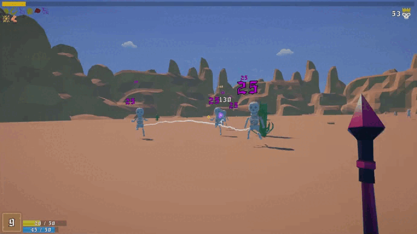
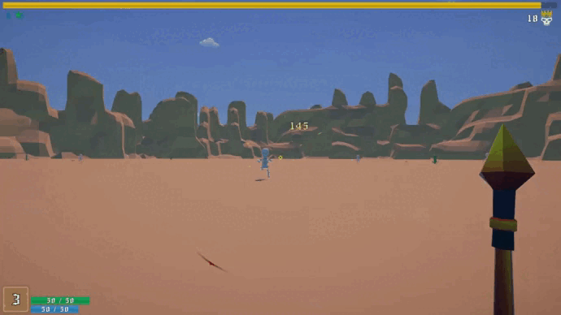
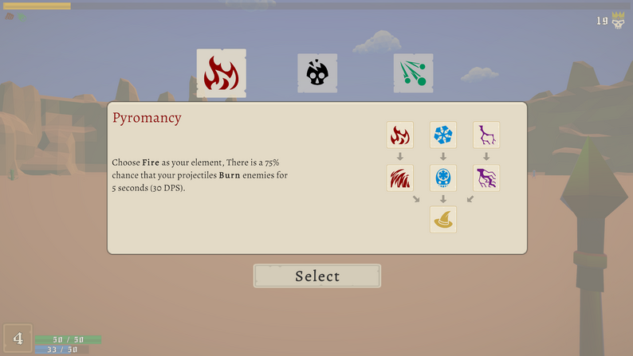
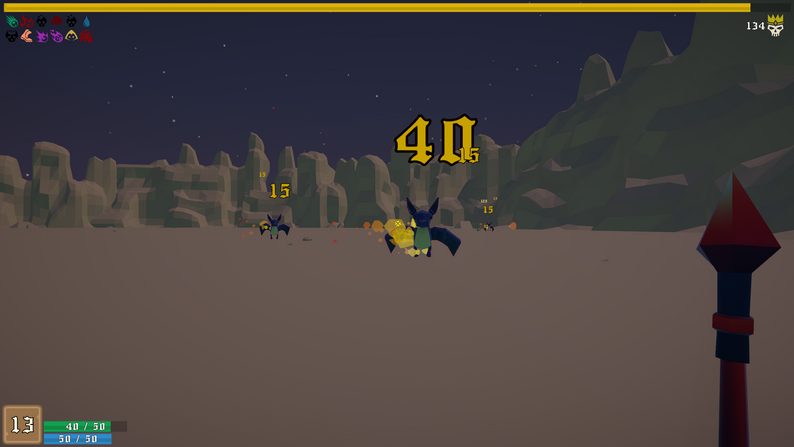
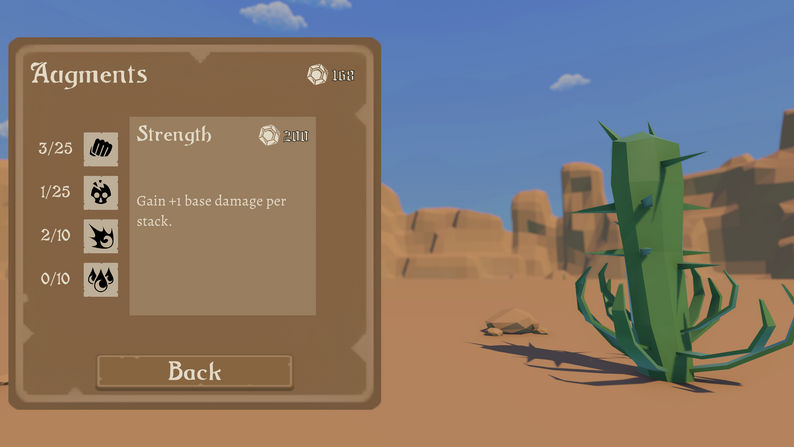

# Sandcaster

A 3D first-person take on *Vampire Survivors*. Play a wizard, survive waves of enemies from day until night, build your spells through upgrades, and take down a giant spider boss. Choose your upgrades wisely, because every run plays differently.

  

  

## Features

- **Upgrade cards:** every level-up offers three upgrades. Pick one and keep following that path to shape your build.
- **Around 30-35 upgrades in families:** each family (a magic class, XP, HP, attack speed and more) is a path that ends in an **ultimate upgrade**, usually the strongest in the family. Finishing a family pays off more than grabbing random upgrades, but you can still combine families into unique runs.
- **Three magic classes:** you can only take one, and once you commit, the other two stop appearing. Each class has 2 unique upgrades and an ultimate.
  - **Pyromancy:** the classic damage-over-time build, with burning enemies
  - **Electromancy:** chain lightning that jumps between enemies
  - **Cryomancy:** slows and stuns enemies to control the crowd
- **XP orbs:** every kill drops one, and you have to pick it up. XP upgrades include a chance to drop extra orbs, or collecting every orb on the map after a number of kills.
- **Enemies with different behaviors:** and if one chases you for too long it goes mad and speeds up, so stalling and not killing them gets you caught.
- **Day to night:** the run starts in daylight and moves into night, when new enemies such as bats begin to spawn.
- **Bosses:** a flying dragon mini boss and a spider final boss.
- **Chaos levels:** beat a run and the next chaos level unlocks, with more enemies and a harder fight.
- **Augments:** permanent upgrades bought with the currency you earn from playing.

### Level-up screen

  

### Classes

  

### Bosses

**Dragon (mini boss):** a small flying dragon.
- **Close range:** spins and damages everything nearby
- **Long range:** shoots a fireball that first marks a circular area, then lands there and hurts you if you're still inside

**Spider (final boss):**
- **Auto attack:** hits hard at close range
- **Lunge:** charges forward at you
- **Spit:** stuns you from range
- **Spiderlings:** at 50% health the boss shields itself and spawns little spiders. The shield also protects other enemies, and you can only hurt the boss once every spiderling is dead.

### Night and Augments

  
  

## Controls

| Input | Action |
|---|---|
| `W` `A` `S` `D` / Arrow keys | Move |
| Hold left click | Shoot |
| Right click | Alternate fire (requires an upgrade) |

## About this project

My first complete game. I started it in 2022 and finished it in 2023, before AI coding tools were part of my workflow, so every system here was written by hand. The project lives in the `FPS-S/` folder.

## Tech

- **Engine:** Unity (C#)
- **Camera:** Cinemachine
- **Platforms:** Windows, macOS, Linux

## Author

**Sina** · [itch.io](https://drxenon.itch.io) · [GitHub](https://github.com/DrXenonn)
